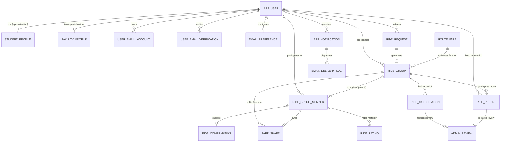

# SynRide — Enhanced Entity-Relationship (EER) Modeling & Relational Mapping

## 1. Overview and Purpose

SynRide is a specialized campus ride-pooling coordination platform for Vellore Institute of Technology (VIT). The system coordinates journey companion finding, vehicle-arranged ride sharing, fare estimation, exact fare allocation, and post-ride dispute resolution.

This document details the conceptual Enhanced Entity-Relationship (EER) design, documenting entity sets, attributes, keys, specialization/generalization hierarchies, and formal mapping into normalized relational tables in Oracle AI Database 26ai Free (`FREEPDB1`).

---

## 2. Conceptual EER Diagram



---

## 3. Specialization Hierarchy: User Supertype & Subtypes

The core requirement demands an **EER Supertype/Subtype Hierarchy** modeling institutional members.

### 3.1 Constraints
- **Supertype:** `APP_USER`
- **Subtypes:** `STUDENT_PROFILE`, `FACULTY_PROFILE`
- **Disjointness Constraint:** **Disjoint (`d`)** — A user cannot be simultaneously a student and a faculty member.
- **Participation Constraint:** **Partial Participation** — An administrative user (`user_role = 'ADMIN'`) belongs to the supertype `APP_USER` but does not possess a student or faculty profile.
- **Defining Attribute:** `user_role` in `APP_USER` (`'STUDENT'`, `'FACULTY'`, `'ADMIN'`).

```
                    ┌─────────────────────────┐
                    │        APP_USER         │
                    │─────────────────────────│
                    │ PK  user_id             │
                    │     full_name           │
                    │     email (UNIQUE)      │
                    │     password_hash       │
                    │     user_role (d)       │
                    │     account_status      │
                    │     created_at          │
                    └────────────┬────────────┘
                                 │
                                (d) [Disjoint / Partial]
                                 │
                    ┌────────────┴────────────┐
                    │                         │
         ┌──────────▼──────────┐   ┌──────────▼──────────┐
         │   STUDENT_PROFILE   │   │   FACULTY_PROFILE   │
         │─────────────────────│   │─────────────────────│
         │ PK,FK1 user_id      │   │ PK,FK1 user_id      │
         │        registration_no│ │        employee_id  │
         │        programme    │   │        staff_cat    │
         │        study_year   │   │        department   │
         └─────────────────────┘   └─────────────────────┘
```

### 3.2 Relational Mapping Approach
The relational mapping implements **Option C (Multiple Relations for Supertype and Subtypes)** from standard database design methodology:
1. `APP_USER` stores attributes common to all users (`user_id`, `full_name`, `email`, `password_hash`, `user_role`, `account_status`, `created_at`).
2. Subtype tables `STUDENT_PROFILE` and `FACULTY_PROFILE` inherit `user_id` as their **Primary Key** and simultaneously declare a **Foreign Key constraint** referencing `APP_USER(user_id)` with `ON DELETE CASCADE`.
3. To reconstruct the complete user entity without procedural code, an academic SQL view `V_USER_PROFILES` performs outer joins across the subtype tables:

```sql
CREATE OR REPLACE VIEW V_USER_PROFILES AS
SELECT 
    u.user_id,
    u.full_name,
    u.email,
    u.user_role,
    u.account_status,
    u.created_at,
    sp.registration_no,
    sp.programme,
    sp.study_year,
    fp.employee_id,
    fp.staff_category,
    fp.department
FROM APP_USER u
LEFT JOIN STUDENT_PROFILE sp ON u.user_id = sp.user_id
LEFT JOIN FACULTY_PROFILE fp ON u.user_id = fp.user_id;
```

---

## 4. Entity Sets and Attributes

| Entity | Attributes | Keys | Notes |
|---|---|---|---|
| **APP_USER** | `user_id`, `full_name`, `email`, `password_hash`, `user_role`, `account_status`, `created_at` | PK: `user_id`<br>AK: `email` | Institutional domain validated: `@vitstudent.ac.in` or `@vit.ac.in`. |
| **STUDENT_PROFILE** | `user_id`, `registration_no`, `programme`, `study_year` | PK, FK: `user_id`<br>AK: `registration_no` | Student subtype specialization. |
| **FACULTY_PROFILE** | `user_id`, `employee_id`, `staff_category`, `department` | PK, FK: `user_id`<br>AK: `employee_id` | Categories: `TEACHING`, `NON_TEACHING`. |
| **USER_EMAIL_ACCOUNT** | `email_account_id`, `user_id`, `verified_email`, `pending_email`, `pending_email_expires_at`, `email_verified_at`, `updated_at` | PK: `email_account_id`<br>FK: `user_id` | Manages verified identity and pending 24h email updates. |
| **USER_EMAIL_VERIFICATION** | `verification_id`, `user_id`, `email_address`, `verification_type`, `otp_hash`, `expires_at`, `failed_attempts`, `status`, `created_at` | PK: `verification_id`<br>FK: `user_id` | OTP hashing via SHA-256; 5 failed attempt threshold. |
| **EMAIL_PREFERENCE** | `preference_id`, `user_id`, `email_enabled`, `updated_at` | PK: `preference_id`<br>FK: `user_id` | User notification toggle (`'Y'`/`'N'`). |
| **RIDE_REQUEST** | `request_id`, `requester_id`, `request_type`, `pickup_location`, `destination`, `departure_time`, `request_status`, `created_at` | PK: `request_id`<br>FK: `requester_id` | Types: `LOOKING_FOR_COMPANIONS`, `VEHICLE_ARRANGED`. |
| **ROUTE_FARE** | `route_id`, `pickup_location`, `destination`, `estimated_fare`, `estimated_duration_minutes`, `is_active`, `updated_at` | PK: `route_id` | Benchmark pricing and duration reference. |
| **RIDE_GROUP** | `group_id`, `request_id`, `coordinator_id`, `departure_time`, `group_status`, `estimated_fare`, `actual_fare`, `created_at`, `confirmation_deadline` | PK: `group_id`<br>FK: `request_id`, `coordinator_id` | Capacity strictly 3 passengers. Lifecycle managed via PL/SQL. |
| **RIDE_GROUP_MEMBER** | `membership_id`, `group_id`, `user_id`, `member_role`, `membership_status`, `joined_at` | PK: `membership_id`<br>FK: `group_id`, `user_id` | Function-based unique index enforces 1 active membership per user. |
| **RIDE_CONFIRMATION** | `confirmation_id`, `membership_id`, `confirmation_status`, `confirmed_at`, `created_at` | PK: `confirmation_id`<br>FK: `membership_id` | 10-minute confirmation deadline window. |
| **FARE_SHARE** | `fare_share_id`, `group_id`, `membership_id`, `share_amount`, `payment_status`, `created_at` | PK: `fare_share_id`<br>FK: `group_id`, `membership_id` | Exact mathematical split with rounding remainder to coordinator. |
| **RIDE_CANCELLATION** | `cancellation_id`, `group_id`, `cancelled_by`, `reason`, `type`, `cancelled_at`, `admin_review_required`, `review_status` | PK: `cancellation_id`<br>FK: `group_id`, `cancelled_by` | Cancellations within 60 min of departure require admin review. |
| **RIDE_RATING** | `rating_id`, `group_id`, `reviewer_membership_id`, `reviewed_membership_id`, `rating`, `review_text`, `created_at` | PK: `rating_id`<br>FK: `group_id`, `reviewer_membership_id`, `reviewed_membership_id` | 1-5 stars. Self-rating disallowed. Anonymous to participants. |
| **RIDE_REPORT** | `report_id`, `group_id`, `reporter_id`, `reported_user_id`, `report_reason`, `description`, `report_status`, `admin_outcome_note`, `created_at`, `resolved_at` | PK: `report_id`<br>FK: `group_id`, `reporter_id`, `reported_user_id` | Behavioral dispute and incomplete ride reporting. |
| **ADMIN_REVIEW** | `review_id`, `group_id`, `cancellation_id`, `report_id`, `assigned_admin_id`, `review_reason`, `status`, `outcome_note`, `created_at`, `reviewed_at` | PK: `review_id`<br>FK: `group_id`, `cancellation_id`, `report_id`, `assigned_admin_id` | Mandatory admin audit record with outcome notes. |
| **APP_NOTIFICATION** | `notification_id`, `user_id`, `group_id`, `notification_type`, `message`, `is_read`, `created_at` | PK: `notification_id`<br>FK: `user_id`, `group_id` | Real-time in-app alert inbox. |
| **EMAIL_DELIVERY_LOG** | `email_log_id`, `notification_id`, `recipient_user_id`, `email_subject`, `attempt_count`, `delivery_status`, `last_attempt_at`, `next_retry_at`, `error_message`, `created_at` | PK: `email_log_id`<br>FK: `notification_id`, `recipient_user_id` | Outbox queue with exponential backoff (1m, 5m). |

---

## 5. Participation Constraints & Relationship Cardinalities

1. **RIDE_GROUP to RIDE_GROUP_MEMBER (1 to N, mandatory min 1, enforced max 3):**
   - Minimum: 1 (the coordinator).
   - Maximum: 3 (coordinator + 2 joined passengers).
   - Enforced by stored procedure `JOIN_RIDE_GROUP` using `SELECT COUNT(*) ... FOR UPDATE` locking to prevent race conditions.
2. **RIDE_GROUP to FARE_SHARE (1 to N):**
   - Each member in a completed ride possesses exactly one `FARE_SHARE` row.
   - Sum of `share_amount` must equal `RIDE_GROUP.actual_fare` to the exact rupee.
3. **RIDE_GROUP to RIDE_CONFIRMATION (1 to N):**
   - Group transition to `'CONFIRMED'` requires **100% unconditional confirmation** from all active members (`COUNT(PENDING) = 0` and `COUNT(CONFIRMED) = member_count`).
4. **APP_USER to RIDE_RATING (N to N recursive):**
   - A participant may rate each other participant in the same ride group exactly once.
   - Enforced via unique constraint on `(group_id, reviewer_membership_id, reviewed_membership_id)` and check constraint `reviewer != reviewed`.
