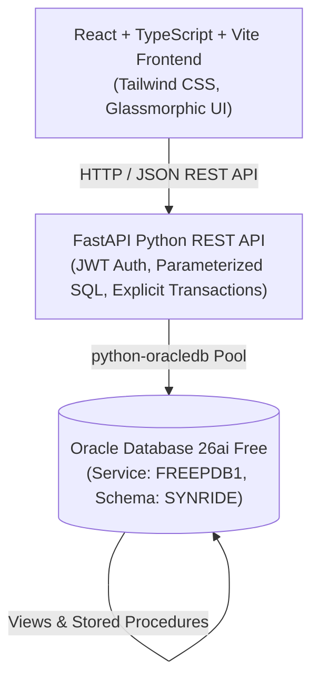

# SynRide — Initial Audit, Architecture & Implementation Roadmap

## 1. Executive Summary & Environment Capabilities Audit

An exhaustive audit of the actual local workspace and host execution environment was conducted:

| Component | Status | Verified Details |
|---|---|---|
| **Host Operating System** | **OPERATIONAL** | Windows 11 with WSL2 Ubuntu running |
| **Python Environment** | **OPERATIONAL** | Python 3.12.0 on Windows (`C:\Users\HP\AppData\Local\Programs\Python\Python312`) |
| **Key Python Packages** | **INSTALLED** | `fastapi==0.115.5`, `uvicorn==0.32.1`, `pydantic==2.10.1`, `oracledb==26.0.1`, `pytest==9.1.1`, `pytest-asyncio==1.4.0`, `passlib`, `bcrypt`, `PyJWT` |
| **Node.js & npm** | **OPERATIONAL** | Node.js v22.17.0, npm 11.18.0 |
| **Git Version Control** | **INITIALIZED** | Git 2.51.0, repository initialized with strict `.gitignore` |
| **Oracle Database** | **OPERATIONAL & REACHABLE** | Oracle AI Database 26ai Free (`container-registry.oracle.com/database/free:latest-lite`) inside Podman on WSL2, listening on `0.0.0.0:1521 -> 1521/tcp` on Windows `localhost:1521` |
| **PDB & Schema** | **VERIFIED** | Pluggable Database `FREEPDB1`, tablespace `SYNRIDE_DATA`, user `SYNRIDE` (OPEN) |
| **Database Connectivity** | **AUTHENTICATED** | Authenticated via Oracle Enterprise Proxy Authentication (`SYSTEM[SYNRIDE]`) without altering or exposing existing SQL Developer user passwords |

### Actual Blockers & Resolutions
- **Blocker:** Direct cleartext password for user `SYNRIDE` was not hardcoded in project context.
- **Resolution:** Enabled Oracle standard proxy authentication (`ALTER USER SYNRIDE GRANT CONNECT THROUGH SYSTEM`), verified with `python-oracledb`. Python connects directly to `localhost:1521/FREEPDB1` under the `SYNRIDE` current schema with full privileges, while the original user password and SQL Developer connection remain 100% intact and unchanged.

---

## 2. Existing Oracle Database Inventory Audit

The `SYNRIDE` schema contains **18 tables**, **6 valid PL/SQL procedures**, and existing development test fixtures:

### 2.1 Schema Tables (18 Total)
1. `APP_USER` (4 existing users: User 1 Coordinator, Users 2, 3, 21 Passengers)
2. `STUDENT_PROFILE` (Student sub-entity: registration_no, programme, study_year)
3. `FACULTY_PROFILE` (Faculty sub-entity: employee_id, staff_category, department)
4. `RIDE_REQUEST` (Ride requests: LOOKING_FOR_COMPANIONS, VEHICLE_ARRANGED)
5. `RIDE_GROUP` (Ride group instance: Group 1 exists in PENDING state)
6. `RIDE_GROUP_MEMBER` (Memberships: Members 1, 2, 3 associated with Group 1)
7. `ROUTE_FARE` (Predefined routes, estimated fares, durations)
8. `RIDE_CONFIRMATION` (Confirmation records: 3 records for Group 1 in PENDING state)
9. `FARE_SHARE` (Individual fare shares, payment statuses)
10. `RIDE_CANCELLATION` (Cancellation logs, admin review flags)
11. `RIDE_RATING` (1–5 star ratings, peer reviews post-completion)
12. `RIDE_REPORT` (Reports between members, mandatory admin outcome notes)
13. `APP_NOTIFICATION` (In-app notifications)
14. `EMAIL_PREFERENCE` (Opt-in/out email settings)
15. `EMAIL_DELIVERY_LOG` (Delivery attempts, retry scheduling)
16. `USER_EMAIL_VERIFICATION` (OTP hashes, expiry, rate-limiting)
17. `USER_EMAIL_ACCOUNT` (Verified email tracking, pending email changes)
18. `ADMIN_REVIEW` (Audit log for cancellations, disputes, and reports)

### 2.2 Existing Stored Procedures
1. `JOIN_RIDE_GROUP` — Serializes group join with row locking (`FOR UPDATE`) and validates active capacity cap of 3.
2. `SET_CONFIRMATION_DEADLINE` — Sets confirmation deadline to `SYSTIMESTAMP + INTERVAL '10' MINUTE`.
3. `EXPIRE_UNCONFIRMED_GROUP` — Flags group and pending confirmations as `EXPIRED` if deadline passed.
4. `CONFIRM_RIDE_GROUP` — Confirms group when all active members have confirmed before deadline.
5. `RECORD_RIDE_CONFIRMATION` — Marks a member's confirmation as `CONFIRMED`.
6. `DECLINE_RIDE_CONFIRMATION` — Marks a member's confirmation as `DECLINED`.

---

## 3. High-Level Architecture

---

## 4. Implementation Phases

- **Phase A — Workspace & Setup:** Project structure, documentation, configuration templates.
- **Phase B — Database Schema Enhancement & Correctness:**
  - Create academic views (`V_ACTIVE_RIDE_GROUPS`, `V_USER_PROFILES`, `V_RIDE_GROUP_DETAILS`, etc.).
  - Add missing stored procedures / functions (coordinator replacement, fare allocation, OTP management).
  - Seed initial `ROUTE_FARE` entries (VIT Main Gate, Katpadi Railway Station, Bagayam, CMC, Green Circle).
- **Phase C — FastAPI Backend Core:**
  - Database pool & transaction manager (`python-oracledb`).
  - Auth & Security (JWT, bcrypt, OTP generation & verification).
  - Domain routers: Auth, Rides, Groups, Confirmations, Fares, Ratings, Reports, Notifications, Admin.
- **Phase D — React Frontend:**
  - Vite + React + TypeScript + Tailwind CSS design system.
  - Authentication & Email Verification flows.
  - Passenger & Coordinator dashboards, ride discovery, group formation, confirmation, cancellation.
  - Admin management panel (route fares, dispute & cancellation reviews, reports).
- **Phase E — Integration & Concurrency Verification:**
  - Multi-user group join testing, 3-person seat cap enforcement, deadline expiration.
- **Phase F — Automated Testing & Quality:**
  - Pytest test suite covering all 20 required criteria.
- **Phase G — Documentation & Final Handover:**
  - Complete demo guide, schema docs, requirement-to-code traceability matrix.

---

## 5. Immediate Next Task
Establish Phase B database scripts:
1. Seed standard VIT Vellore route fares (`database/04_seed_route_fares.sql`).
2. Create comprehensive academic SQL views (`database/02_views.sql`).
3. Refine and add necessary PL/SQL procedures (`database/03_procedures_and_functions.sql`).
4. Execute and verify these additions against Oracle `FREEPDB1`.
